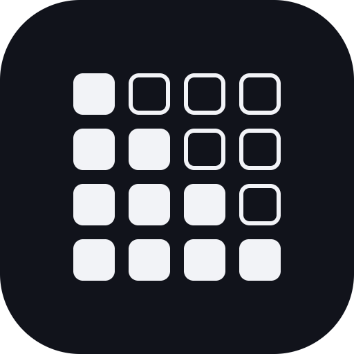
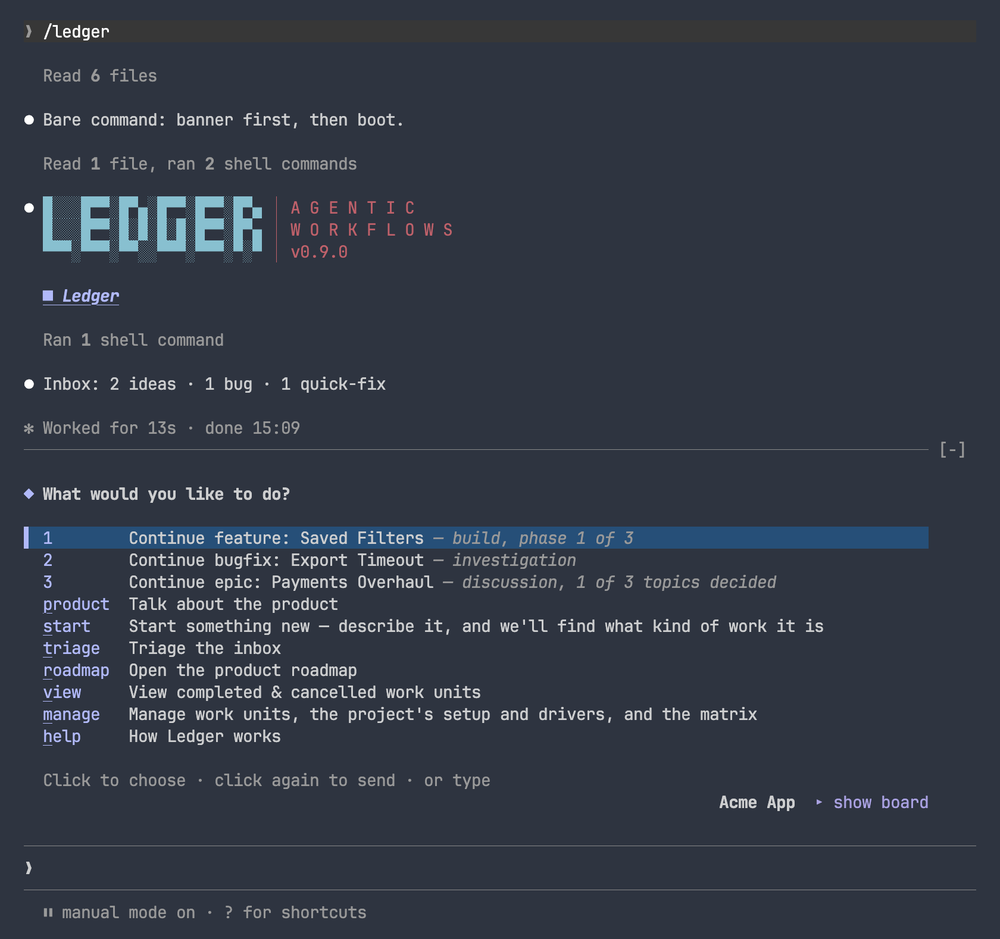
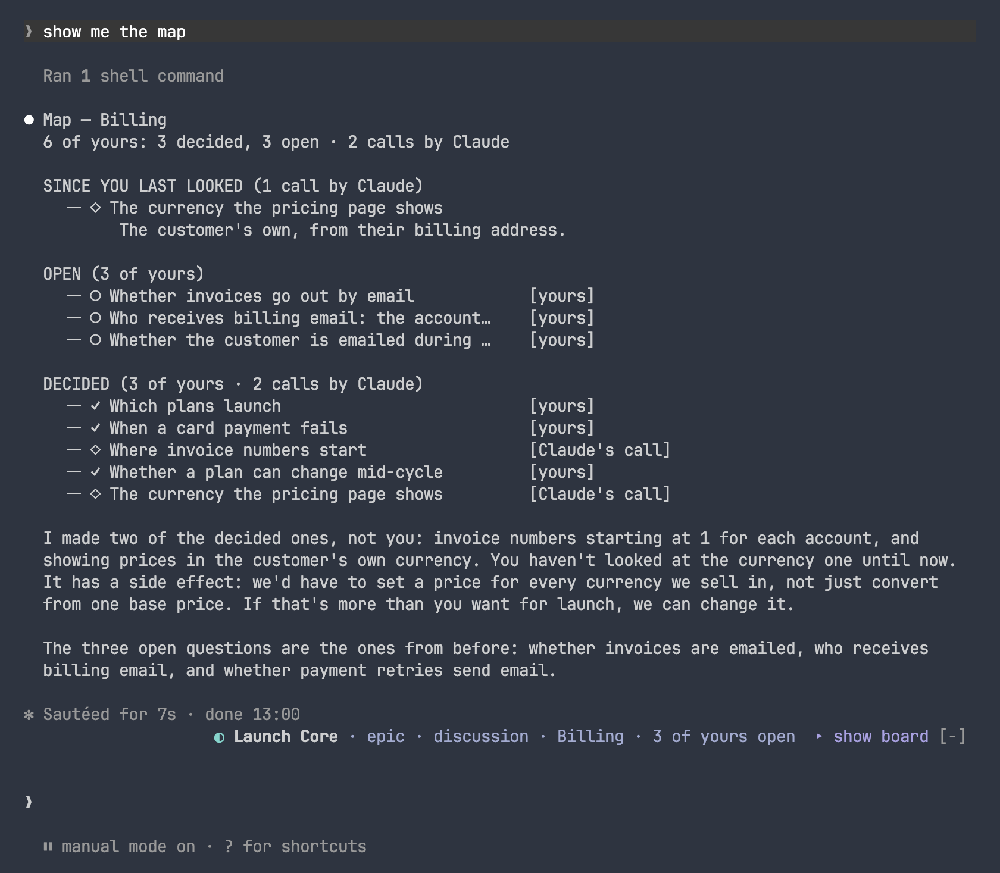
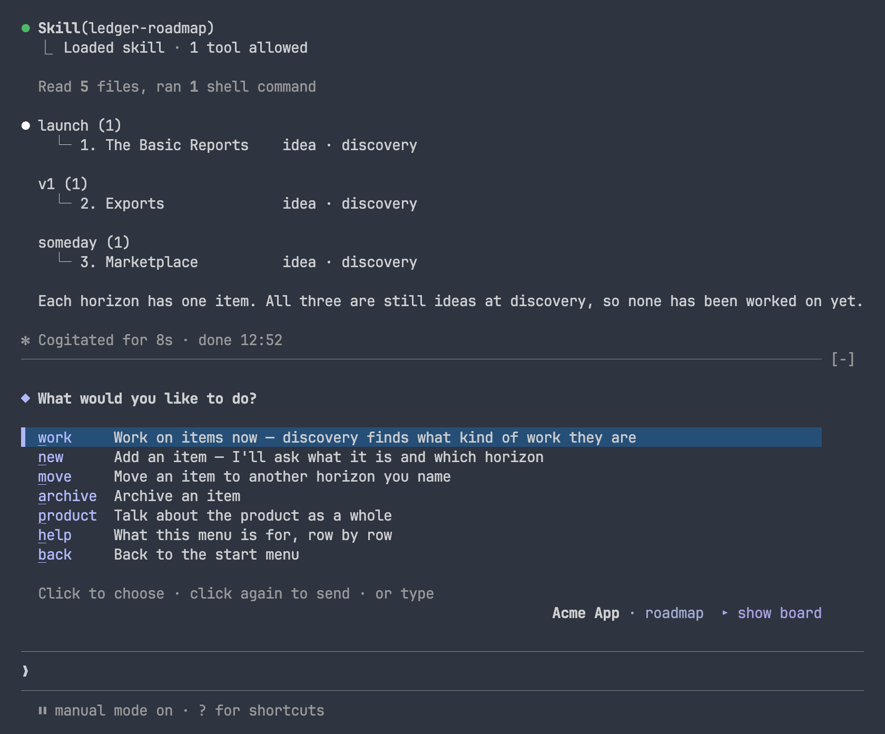

<div align="center">



# Ledger

**A complete engineering process for Claude Code, from first idea to reviewed code.**

Ledger lets Claude decide, the way you would. It learns your taste from your own answers, across all your projects, and hands Claude more of the calls as its judgement proves right.

Start with `/ledger`, or ask Claude in your own words, and the work takes the shape it needs, from a one-line fix to an epic of many topics. You approve one spec, and the build runs on its own, each task proven by running the product, with every decision carried into the work that follows, through compactions and new sessions.

[](https://github.com/leeovery/ledger/releases)
[](LICENSE)
[](docs/configuration.md)

[Docs](docs/README.md) · [Work types](docs/work-types.md) · [Trust](docs/trust.md) · [The build](docs/the-build.md) · [Configuration](docs/configuration.md)



</div>

---

## Why Ledger?

Ledger stays out of the way. Nothing about how you talk to Claude changes: a few familiar surfaces, such as a menu and a board beside the conversation, and the rest happens in the talk, adding to what Claude does rather than holding it back.

- **Your taste, learned once.** Each answer you give, in any project, teaches Claude which calls it can make for you, and a matrix shows where each kind of call stands. [Trust](docs/trust.md)
- **A changed mind reaches everything.** Replace a decision and everything that relied on it is flagged, and later work asking "what did we decide about X?" gets the decision itself. [The knowledge base](docs/knowledge-base.md)
- **A build that runs itself.** Tasks are built side by side in their own worktrees and reviewed by agents that didn't write them, and a question for you parks only the tasks that depend on it. [The build](docs/the-build.md)
- **Proven by running it.** Builders drive the running product the way a user would, and a script, never Claude's account, writes the verdict. [Verification](docs/verification.md)
- **Nothing said in passing is lost.** Mention an idea, a bug or a rule for CLAUDE.md mid-conversation, and Claude keeps it where it belongs while the work carries on. [Tracking](docs/tracking.md)
- **Picks up where it left off.** After a compaction, a crash or a new session, the work reads its record again and carries on, with no recap. [Reliability](docs/reliability.md)

## What it looks like

|  |  |
|:---:|:---:|
| <a href="docs/discussion.md"></a><br>**A topic's map**<br>What's decided, by you or by Claude, and what's open | <a href="docs/tracking.md"></a><br>**The roadmap**<br>What's decided on, and which horizon it's for |

Every screen is drawn by the engine from the state on disk and shown exactly as drawn, so Claude can't editorialise where your work stands. With Ledger's Claude Code mod, every menu is a row of buttons above the prompt.

## How the work flows

Work comes in four shapes, each with a pipeline sized to it. An epic has many topics, all decided before its one spec is written; a feature has one.

| Type | Pipeline |
|---|---|
| Epic | Discovery → Discussion → Specification → Implementation → Review |
| Feature | Discovery → Discussion → Specification → Implementation → Review |
| Bugfix | Discovery → Investigation → Specification → Implementation → Review |
| Quick-fix | Discovery → Implementation → Review (on request) |

**Discussion.** Each topic gets a conversation of its own. Claude pushes back, finds the questions nobody has answered yet, and records each decision as it's made. When a decision rests on a number nobody has measured, the discussion can run an experiment, designed before it runs. [Discussion](docs/discussion.md)

**The spec.** The decided topics become one spec, every statement citing the ledger entries it comes from. It's cut into phases, and you approve it at its last step, ready to build. There you pick how the build runs. Auto runs on its own and stops only for what needs you; step also stops after each task for you to try it. [Specification](docs/specification.md)

**The build.** Each phase's tasks are written as the phase starts, and builders work each in a worktree of its own, with the tests that prove it. In auto, tasks that share no files are built side by side. Reviewers who didn't write the code check each task, and a pair checks each phase's whole change against the spec. On GitHub, every task lands as its own pull request, and each phase as a stack of them. [The build](docs/the-build.md)

**Review.** The built change is held against the spec. What the review finds in the change comes back as fix tasks, and what lies beyond it goes to the inbox. [Review](docs/review.md)

## More features

- **Starting in an existing codebase.** Your first session offers to have a researcher read the code. What the code shows lands on the ledger as findings, and what it leaves open becomes the first questions you talk through. [Discovery](docs/discovery.md)
- **The inbox and the roadmap.** An idea or a bug mentioned mid-conversation lands in the inbox, for you to triage later. Say "that's a v2 thing" anywhere and it's on the roadmap in one line. [Tracking](docs/tracking.md)
- **Work that changes shape.** A feature that outgrows its scope pivots into an epic, and one that belongs inside an epic is absorbed as a topic. Cancelled work comes back. [Lifecycle](docs/lifecycle-operations.md)
- **State on its own branch.** Ledger keeps its records on a branch of their own, `ledger-state`, beside your code and pushed after every commit. Pull requests never carry it, a second machine catches up on its own, and on GitHub setup offers a rule protecting it. [State and git](docs/state-and-git.md)
- **Many sessions, one checkout.** Talk through as many topics side by side as you like. Each commit holds what that session wrote, never another session's half-made change. A build and a review take turns with the code. [Reliability](docs/reliability.md)
- **Your tracker and your code host.** Tasks are kept in a tracker and land in your repository, each through a driver. The tracker that ships is Tick. Code lands on GitHub as stacked pull requests, or as local branches where there's no remote or it's on another host. [The build](docs/the-build.md)
- **Session labels.** Working inside tmux? Opt in, and your session's label shows where you are, such as `myproject · payments · discussion`. [Configuration](docs/configuration.md)
- **Upgrades that migrate themselves.** An update moves existing projects to the new version in place, on the next run. A project from before Ledger is moved across too. [State and git](docs/state-and-git.md)

## Install

Needs Node 18+, git 2.40.0+, a git repository and Claude Code 2.1.287+. Ledger is built for Claude Code's terminal app and the Desktop app's Code tab. On the web or in the VS Code extension, its menus print as text and support is soft. Run your session at medium effort or above.

```bash
npx agntc add leeovery/ledger
```

Commit the installed files to share Ledger with your team. `npx agntc update` pulls the latest, and `npx agntc remove leeovery/ledger` uninstalls it.

The build's tracker needs [Tick](https://github.com/leeovery/tick) 0.3.0+, a task tool built for coding agents. Landing on GitHub needs GitHub's CLI 2.30.0+ with its stack extension. Search by meaning is optional: it needs an OpenAI key, which you enter in your terminal, never the chat. [Configuration](docs/configuration.md)

## Quick start

```text
# In Claude Code, in your project
/ledger
```

Your first session sets everything up in chat, then asks what you'd like to work on. You can also skip `/ledger` and ask Claude for a change in your own words.

## Documentation

The [full documentation](docs/README.md) follows a piece of work from first idea to reviewed code. Start with these:

| Page | Contents |
|---|---|
| [Introduction](docs/introduction.md) | What Ledger is, and your part in it |
| [Work types](docs/work-types.md) | Epic to quick-fix, each pipeline in full |
| [Trust](docs/trust.md) | The ledger, the ask rule, verdicts and the matrix |
| [The build](docs/the-build.md) | Phases, tasks, the reviews, pull requests and the drivers |
| [Verification](docs/verification.md) | Proving the work by running the product |
| [State and git](docs/state-and-git.md) | The state branch, pushing, a second machine |
| [Configuration](docs/configuration.md) | Install, effort, the drivers, the environment setup |

Contributing? [docs/contributing.md](docs/contributing.md) covers setup, the test gates and the gotchas worth knowing first.

## License

MIT
